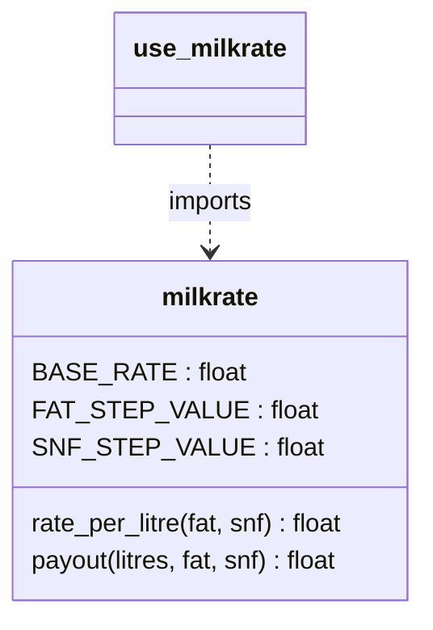

# Task 7 - Build a Module (K4)

Files: `milkrate.py` (the module, Complete-the-Code solution), `use_milkrate.py` (separate script that imports it)

Run:
```
python milkrate.py          # runs the module directly -> prints the table
python use_milkrate.py      # imports it -> the table is NOT printed
```

## Complete the Code
```python
fat_steps = round((fat - 3.5) / 0.1)          # TODO 1
snf_steps = round((snf - 8.5) / 0.1)
return round(BASE_RATE + fat_steps * FAT_STEP_VALUE + snf_steps * SNF_STEP_VALUE, 2)
...
return round(litres * rate_per_litre(fat, snf), 2)   # TODO 2
```
Output (identical to the expected output, see `output_milkrate.txt`):
```
   10 L  fat 3.5  snf 8.5  rate  30.00  pay   300.00
  8.5 L  fat 4.2  snf 8.7  rate  33.40  pay   283.90
   12 L  fat 3.1  snf 8.3  rate  27.80  pay   333.60
```

## import forms
| Statement | Name you use | Notes |
|---|---|---|
| `import milkrate` | `milkrate.payout(...)` | whole module under one name; no clashes |
| `from milkrate import payout` | `payout(...)` | only that name enters your namespace; shorter, can clash with another `payout` |
| `import milkrate as mr` | `mr.payout(...)` | alias for long names |
All three refer to the **same** function object (`is` test in the output).

## The `if __name__ == "__main__":` test
When a file is run directly, Python sets `__name__ = "__main__"`; when it is imported, `__name__` is the module name (`'milkrate'`). The demo table is under the `if`, so it runs when you execute `milkrate.py` but **not** when `use_milkrate.py` imports it - the output of `use_milkrate.py` starts without a table. Section 5 of that output writes a module *without* the guard: its `print` runs as soon as it is imported, which is unwanted behaviour for a library.

## Standard modules
`math` (floor, isfinite), `decimal` (exact money, from Task 9), `time` (`perf_counter`), `random`, `csv`, `json`.

## Where Python looks for a module
1. the folder of the running script (`sys.path[0]`), 2. `PYTHONPATH`, 3. the standard library, 4. site-packages. The output prints the first entries of `sys.path` and `milkrate.__file__`. If `milkrate.py` is in another folder you must add it to `sys.path` or `PYTHONPATH`.

## Alternative concept and complexity analysis
**Copy the functions into every script** that needs them: each copy must be corrected when a rate changes (k scripts = k edits; one forgotten copy = a partial revision, the original problem). With a module, one edit of `milkrate.py` updates every script.
**Import cost:** the first `import` reads and executes the file once (about a millisecond for this small file in the output), then Python stores the module in `sys.modules`; the second import is a dictionary lookup (about a microsecond, O(1)). `importlib.reload` forces a re-read. The one-time cost is negligible compared with the work saved; space is one module object, O(1) regardless of how many scripts import it.



## Evidence
`output_milkrate.txt`, `output_use_milkrate.txt` (below).

## Program output (as produced by my run)

### output_milkrate.txt
```
   10 L  fat 3.5  snf 8.5  rate  30.00  pay   300.00
  8.5 L  fat 4.2  snf 8.7  rate  33.40  pay   283.90
   12 L  fat 3.1  snf 8.3  rate  27.80  pay   333.60
```

### output_use_milkrate.txt
```
(no table was printed above: milkrate.__name__ is 'milkrate',
 not '__main__', so the block under  if __name__ == '__main__'  was skipped)

1) Three ways of importing
   milkrate.payout(8.5, 4.2, 8.7)      = 283.9
   payout(8.5, 4.2, 8.7)               = 283.9
   mr.rate_per_litre(3.1, 8.3)         = 27.8
   same function object? True

2) This script's own __name__ = '__main__'

3) Where Python looks for modules (first 3 entries of sys.path)
   /home/claude/CSA08-REGNO-Assignment1/Task07
   /usr/lib/python312.zip
   /usr/lib/python3.12
   milkrate was loaded from: /home/claude/CSA08-REGNO-Assignment1/Task07/milkrate.py

4) Import cost: Python loads a module once and keeps it in sys.modules
   'milkrate' in sys.modules: True
   first import :     107.1 microseconds
   second import:       0.4 microseconds (from sys.modules)
   reload       :     123.2 microseconds (re-reads the file)

5) What happens WITHOUT the  if __name__ == '__main__'  guard
   >>> noguard: this table line prints on import!
   The module printed text just because it was imported.
```

## Screenshots
Put your own screenshots of each run in the `screenshots/` folder of this task and name them like `Task07_run1.png`.
