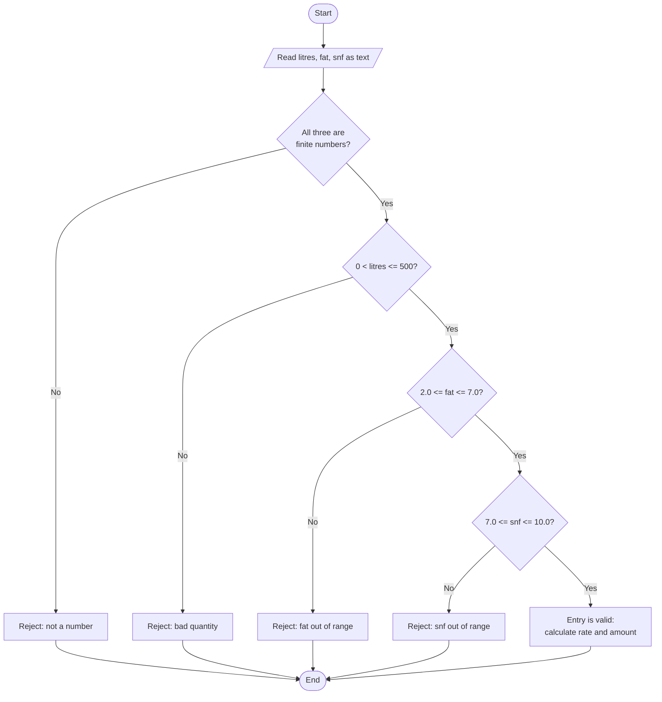

# Task 8 - Pseudocode, Flowchart and Hand Trace

## 1. Pseudocode - payment of ONE entry

```
ALGORITHM  EntryPayment
INPUT      litres, fat, snf
OUTPUT     rate, amount
CONSTANTS  BASE_RATE <- 30.00
           FAT_STEP_VALUE <- 0.40
           SNF_STEP_VALUE <- 0.30
           STD_FAT <- 3.5,  STD_SNF <- 8.5,  STEP <- 0.1
BEGIN
    fat_steps <- ROUND( (fat - STD_FAT) / STEP )          // nearest whole step
    snf_steps <- ROUND( (snf - STD_SNF) / STEP )
    rate      <- BASE_RATE + fat_steps * FAT_STEP_VALUE + snf_steps * SNF_STEP_VALUE
    rate      <- ROUND_TO_PAISA(rate)
    amount    <- ROUND_TO_PAISA(litres * rate)            // rounded ONCE, half up
    RETURN rate, amount
END
```

## 2. Pseudocode - ten-day total for ONE farmer (running total)

```
ALGORITHM  TenDayTotal
INPUT      list of entries (litres, fat, snf), n entries
OUTPUT     ten_day_total
BEGIN
    ten_day_total <- 0.00
    FOR each entry IN entries DO
        IF entry is NOT valid THEN                        // see flowchart
            DISPLAY "rejected" and the reason
        ELSE
            (rate, amount) <- EntryPayment(litres, fat, snf)
            ten_day_total  <- ten_day_total + amount      // amount already rounded
        END IF
    END FOR
    RETURN ten_day_total
END
```
Complexity: time O(n), extra space O(1).

## 3. Flowchart - validate one entry



## 4. Hand trace (three entries)

| i | litres | fat | snf | fat_steps = round((fat-3.5)/0.1) | snf_steps = round((snf-8.5)/0.1) | rate = 30 + fs*0.40 + ss*0.30 | amount = litres*rate | ten_day_total |
|---|---|---|---|---|---|---|---|---|
| start | | | | | | | | 0.00 |
| 1 | 10 | 3.5 | 8.5 | 0 | 0 | 30.00 | 300.00 | 300.00 |
| 2 | 8.5 | 4.2 | 8.7 | 7 | 2 | 30 + 2.80 + 0.60 = 33.40 | 8.5 x 33.40 = 283.90 | 583.90 |
| 3 | 12 | 3.1 | 8.3 | -4 | -2 | 30 - 1.60 - 0.60 = 27.80 | 12 x 27.80 = 333.60 | **917.50** |

The program `task08_algorithm.py` prints the same table (see `output_task08_algorithm.txt`).
