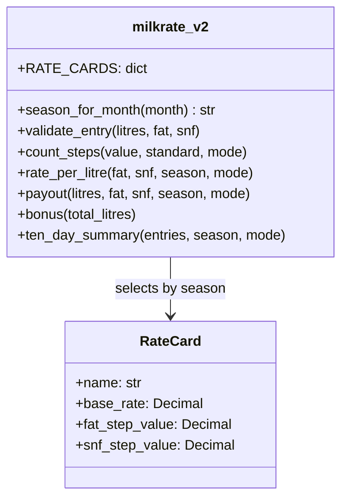

# Task 12 - Day-4 Design Challenge: Re-evaluate and Adapt the Design (K5)

Files: `milkrate_v1.py` (the ORIGINAL float module of Task 7, unchanged), `milkrate_v2.py` (adapted design), `evaluate_old_design.py` (Part B evidence), `test_task12.py` (Part D evidence)

Run: `python evaluate_old_design.py` and `python test_task12.py`

## Changed requirements
1. The analyser sends fat and SNF with **two decimals** (for example 3.57).
2. **Seasonal rates:** April-June base rate Rs 32.00 and fat step Rs 0.45 (the SNF step is not mentioned, so it stays Rs 0.30 - assumption).
3. **Bonus:** more than 500 litres in ten days -> Rs 0.50 per litre. Assumption: the bonus is paid on **all** litres of the ten days (not only the excess), it is not limited to one season, and exactly 500 L earns no bonus ("more than 500").

## A. Impact analysis (2 marks)
| Part of the design | Affected? | Why |
|---|---|---|
| `BASE_RATE`, `FAT_STEP_VALUE` | **Yes** | the value depends on the month; one global value is no longer enough |
| `SNF_STEP_VALUE`, `STD_FAT`, `STD_SNF`, `STEP` | No | unchanged |
| `rate_per_litre(fat, snf)` | **Yes** | needs to know the season; step counting must handle 2-decimal readings |
| `payout(litres, fat, snf)` | **Yes** (small) | passes the season on |
| `ten_day_total(entries)` | **Yes** | must also add the bonus, which depends on the total litres of the ten days |
| Input validation | **Yes** (small) | must accept 2 decimals and reject 3 or more |
| Decimal type, rounding rule, tests, module structure | No | still valid |
**Two-decimal readings and the step calculation.** Before, a reading such as 3.5 or 3.6 was always a whole number of steps. Now 3.57 is 0.7 of a step. Rounding it to the nearest whole step (the old rule) pays 3.57 % exactly like 3.60 % (Rs 0.40/L extra) although it is only Rs 0.28/L richer; with 10 litres that is Rs 1.20 per entry. I therefore count steps **proportionally**: `(fat - 3.5) / 0.1` as an exact Decimal (3.57 -> 0.7 steps), and round only the final rate to the paisa. The old rule is kept as `mode="nearest"` so the union can choose (it is a business rule that must be confirmed).
Rounding: with 2-decimal readings, exact ties become common (x.x5 readings), so the float approach is even less reliable (see Part B).

## B. Evaluation of the original design (2 marks)
Results of `evaluate_old_design.py`:
* **Worked examples (standard season, 10 L).** Old module vs new: reading 3.54 / 8.54: old Rs 300.00, correct Rs 302.80; reading 3.57 / 8.53: old Rs 304.00, correct Rs 303.70; reading 4.23 / 8.68: old Rs 334.00, correct Rs 334.60. The old module ignores the second decimal for the step and so pays the wrong amount (up to Rs 2.80 on 10 L).
* **Float step counting on ties.** Of the 501 fat readings 2.00-7.00, float `round((fat-3.5)/0.1)` and exact Decimal counting disagree on **29** (for example fat 2.25 gives -12 with float, -13 with Decimal; fat 2.35 is `-11.499999999999998` in float). The original float design cannot be trusted with 2-decimal readings.
* **Seasons and bonus.** The module has one `BASE_RATE = 30.00` and one `FAT_STEP_VALUE = 0.40`; a summer entry of 10 L at 3.5 / 8.5 pays Rs 300.00 instead of Rs 320.00. Changing the constants at run time would be global state; copying the module per season duplicates code (the original bug). No function sees the ten-day litres, so the bonus has nowhere to live.
**Evaluation:** the *ideas* of the original design (named constants, one module, small functions, validation, tests, Decimal and per-payment rounding from Tasks 9-11) remain appropriate; the *float module* of Task 7 and its single-card constants do not.

## C. Adaptation (2 marks) - decision: MODIFY (keep the structure, extend it)
* **RETAIN:** module + small functions, Decimal from text, `ROUND_HALF_UP`, round each payment once, validation, assert-based tests.
* **MODIFY:** constants become **data**: `RATE_CARDS = {"standard": RateCard(...), "summer": RateCard(...)}`; `rate_per_litre(fat, snf, season, mode)` and `payout(...)` take the season as a parameter; `season_for_month(month)` selects the card (April-June -> `"summer"`); validation accepts at most 2 decimals; `count_steps(value, standard, mode)` supports `"proportional"` and `"nearest"`.
* **ADD:** a separate `bonus(total_litres)` function and `ten_day_summary(entries, season)` which returns litres, base amount, bonus and total.
* A full redesign was **not** needed: the structure was right, only the rate card became a parameter. Adding a new season later = one new `RateCard` line.



Example use:
```python
from decimal import Decimal as D
import milkrate_v2 as m
season = m.season_for_month(5)                       # 'summer'
entries = [m.validate_entry("170", "3.57", "8.53")] * 3
print(m.ten_day_summary(entries, season))
```

## D. Evidence-based defence (2 marks)
`test_task12.py` result (all PASS, see the output):
* **Both seasons:** S1/S2 (10 L at 3.50/8.50) Rs 320.00 summer vs Rs 300.00 standard; S3/S4 (4.20/8.70) Rs 357.50 vs Rs 334.00 - checked by hand: summer 32.00 + 7 x 0.45 + 2 x 0.30 = 35.75.
* **Two-decimal readings:** S5/S6 (3.57/8.53) summer Rs 32.41 per litre, standard Rs 30.37 (proportional) against Rs 30.40 in `nearest` mode (S7); S8 minimum readings, S9 half-paisa case (31.775 -> 31.78).
* **Bonus:** 510 L -> bonus Rs 255.00; exactly 500 L -> Rs 0.00; 500.1 L -> Rs 250.05; standard season 600 L -> Rs 300.00.
* **Invalid input:** 3-decimal fat, fat above 7.0, zero litres, text, comma - all rejected; month 13 rejected.
**Trade-offs.**
1. *Proportional vs nearest step:* proportional pays what the analyser measured (fairer, matches the 0.01 % resolution), but it changes the published rate chart (rates now have paise); `mode` lets the union switch back without rewriting code.
2. *Bonus on all litres vs only the excess:* assumed all litres (the text says "Rs 0.50 per litre"); one constant (`BONUS_PER_LITRE`) and one function to change if the union meant the excess only.
3. *Data in a dictionary in the module vs a JSON file (Task 11):* the dictionary is simpler and tested together with the code; moving `RATE_CARDS` to the JSON loader of Task 11 is a small change if the union revises rates often.
4. *Cost:* extra code is a few dozen lines; execution cost is the same O(1) per entry and O(n) per ten-day run as before (Task 10).
I therefore recommend the **modified** design: it removes the float errors, keeps everything that was already tested, and each new rule lives in one named place.

## Evidence
`output_evaluate_old_design.txt`, `output_test_task12.txt` (below).

## Program output (as produced by my run)

### output_evaluate_old_design.txt
```
1) Two-decimal readings: old design vs new design (standard season, 10 litres)
     fat   snf |  old rate   old pay |  new rate   new pay |  old-new
    3.50  8.50 |     30.00    300.00 |     30.00    300.00 |     0.00
    3.54  8.54 |     30.00    300.00 |     30.28    302.80 |    -2.80
    3.57  8.53 |     30.40    304.00 |     30.37    303.70 |     0.30
    3.64  8.46 |     30.40    304.00 |     30.44    304.40 |    -0.40
    4.23  8.68 |     33.40    334.00 |     33.46    334.60 |    -0.60
   The old module rounds 3.57 % to the 3.6 % step, so the farmer is overpaid or underpaid.

2) Tie readings (x.x5): float step counting vs exact Decimal step counting
   fat readings 2.00 .. 7.00 where float and Decimal disagree on the step: 29 of 501
   fat 2.25: float steps = -12.5 -> round gives -12, Decimal gives -13
   fat 2.35: float steps = -11.499999999999998 -> round gives -11, Decimal gives -12
   fat 2.45: float steps = -10.499999999999998 -> round gives -10, Decimal gives -11
   fat 2.65: float steps = -8.5 -> round gives -8, Decimal gives -9

3) What the old module cannot express
   - It has ONE BASE_RATE = 30.00 and ONE FAT_STEP_VALUE = 0.40 (module-level names).
   - Summer rates need base 32.00 and fat step 0.45: the module would have to be edited,
     or the constants changed at run time (global state - dangerous).
   - No function knows about ten-day litres, so the Rs 0.50 bonus has no place to live.
   old payout for summer entry 10 L, 3.5 / 8.5 = 300.0 (should be 320.00)
```

### output_test_task12.txt
```
ID  Season    Mode         Input (L, fat, snf)   Expected rate/pay   Actual rate/pay     Result
-----------------------------------------------------------------------------------------------
S1  summer    proportional 10, 3.50, 8.50        32.00/320.00        32.00/320.00        PASS
S2  standard  proportional 10, 3.50, 8.50        30.00/300.00        30.00/300.00        PASS
S3  summer    proportional 10, 4.20, 8.70        35.75/357.50        35.75/357.50        PASS
S4  standard  proportional 10, 4.20, 8.70        33.40/334.00        33.40/334.00        PASS
S5  summer    proportional 10, 3.57, 8.53        32.41/324.10        32.41/324.10        PASS
S6  standard  proportional 10, 3.57, 8.53        30.37/303.70        30.37/303.70        PASS
S7  standard  nearest      10, 3.57, 8.53        30.40/304.00        30.40/304.00        PASS
S8  summer    proportional 10, 2.00, 7.00        20.75/207.50        20.75/207.50        PASS
S9  summer    proportional 10, 3.45, 8.50        31.78/317.80        31.78/317.80        PASS

Invalid readings
V1  fat with 3 decimals     ValueError expected   PASS
V2  fat above 7.0           ValueError expected   PASS
V3  zero litres             ValueError expected   PASS
V4  text litres             ValueError expected   PASS
V5  snf with comma          ValueError expected   PASS

Season by month
   month  1 -> standard  PASS
   month  3 -> standard  PASS
   month  4 -> summer    PASS
   month  5 -> summer    PASS
   month  6 -> summer    PASS
   month  7 -> standard  PASS
   month 12 -> standard  PASS
   month 13 -> ValueError PASS

Ten-day bonus (more than 500 L earns Rs 0.50 per litre on all litres)
ID  Season      Litres        Base    Bonus       Total   Result
B1  summer         510    16320.00   255.00    16575.00   PASS
B2  summer         500    16000.00     0.00    16000.00   PASS
B3  summer       500.1    16003.20   250.05    16253.25   PASS
B4  standard       600    18000.00   300.00    18300.00   PASS
----------------------------------------------------------------------------------
failures: 0
All Task 12 tests passed.
```

## Screenshots
Put your own screenshots of each run in the `screenshots/` folder of this task and name them like `Task12_run1.png`.
